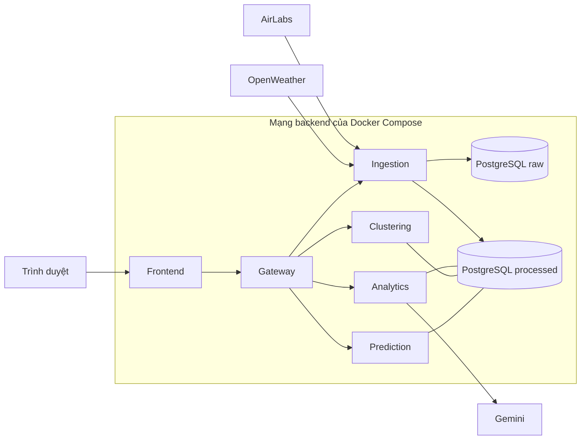
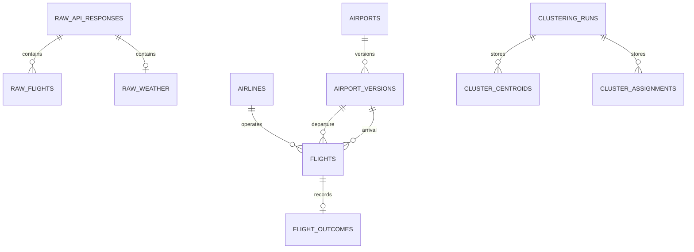

# Flight Observatory — Live APIs

Luồng mặc định: **AirLabs schedules + OpenWeather → Ingestion lưu `flight_raw_db` → chuẩn hóa vào `flight_processed_db` → Analytics / Clustering / Prediction → Frontend**.
Không khởi động simulator, không mount CSV và không fallback sang CSV trong chế độ live.

## 1. Cấu hình

Mở `backend/.env` (copy từ `.env.example` nếu chưa có):

```dotenv
AIRLABS_API_KEY=your_key
AIRLABS_AIRPORTS=JFK
AIRLABS_MAX_PAGES=1
AIRLABS_MONTHLY_BUDGET=800
AIRLABS_RESET_DAY=1
OPENWEATHER_API_KEY=your_key
OPENWEATHER_MONTHLY_BUDGET=10000
OPENWEATHER_RESET_DAY=1
WEATHER_CACHE_SECONDS=900
INGESTION_INTERVAL_SECONDS=300
```

Không gửi key vào frontend. Các hạn mức ở trên là ngân sách do ứng dụng tự đặt, không phải cam kết quota của nhà cung cấp. Đặt ngày reset và ngân sách theo dashboard, trừ lượt đã dùng bên ngoài ứng dụng. Bộ đếm không tự đồng bộ với nhà cung cấp.

Backend tự lên lịch ingestion mỗi 300 giây theo mặc định. Hai lượt bắt đầu cách nhau tối thiểu 300 giây. Mốc lượt gần nhất lưu trong DB để lần khởi động lại dùng chung lịch. Một sân bay/một trang mỗi 5 phút chạy 24/7 cần khoảng 8.640 request schedules/30 ngày, chưa tính tra sân bay. Với budget 800, service sẽ dừng gọi khi hết budget và giữ dữ liệu đã lưu.

Mỗi trang schedules yêu cầu tối đa 50 dòng. Tăng `AIRLABS_MAX_PAGES` trong `.env` (ví dụ `2`) để lấy thêm trang khi nguồn còn dữ liệu. Mỗi trang và mỗi lượt tra sân bay chưa có cache tính riêng vào ngân sách AirLabs. Nếu chạm giới hạn phân trang, `/providers` ghi coverage partial. `AIRLABS_AIRPORTS=JFK` lấy chuyến khởi hành từ JFK, gồm cả tuyến quốc tế.

## 2. Chạy Docker

Từ thư mục `backend`:

```powershell
docker compose up --build -d --remove-orphans
docker compose ps
docker compose logs -f --tail 100 ingestion
```

`--remove-orphans` gỡ container simulator cũ thuộc cùng Compose project. Không xóa volume PostgreSQL. Không dùng `down -v` khi muốn giữ dữ liệu.

- Frontend: http://localhost:3000
- Ingestion Swagger: http://localhost:2002/api/ingestion/docs
- Trạng thái nguồn/quota: http://localhost:2002/api/ingestion/providers
- Chuyến bay: http://localhost:2002/api/ingestion/flights
- Snapshot response đã lưu: http://localhost:2002/api/ingestion/raw

Khi sửa `.env`, chạy `docker compose up -d ingestion` để tạo lại container với biến mới. `restart` không nạp lại cấu hình Compose. Khi sửa code, thêm `--build`.

Thiếu key vẫn khởi động được và `/providers` báo nguồn chưa sẵn sàng. Tải lại trang và đổi bộ lọc chỉ đọc dữ liệu đã lưu. Scheduler backend là điểm khởi chạy lượt thu thập AirLabs và OpenWeather.

## 3. Nhiều tài khoản

Chỉ cấu hình tài khoản được phép dùng cho ứng dụng. `AIRLABS_ACCOUNTS` là JSON một dòng, ghi trong dấu nháy đơn của `.env`. Khi có biến này, nó thay thế `AIRLABS_API_KEY`/`AIRLABS_AIRPORTS`:

```dotenv
AIRLABS_ACCOUNTS='[{"name":"team_a","key":"KEY_A","airports":["JFK"],"quota_group":"account_a","budget":800,"reset_day":1},{"name":"team_b","key":"KEY_B","airports":["ORD"],"quota_group":"account_b","budget":800,"reset_day":1}]'
```

Mỗi sân bay chỉ gán một lần. Key dùng chung quota phải cùng `quota_group`, `budget`, `reset_day`. Không tự chuyển sang tài khoản khác khi hết quota. Lượt schedules, airports, phân trang và request lỗi đều được tính trước khi gửi; mất kết nối vẫn tính bảo thủ. Lỗi giới hạn kích hoạt thời gian chờ lưu trong DB. Tạo key mới không tự thêm quota.

## 4. Database và dữ liệu

PostgreSQL có hai database: `flight_raw_db` giữ từng response API trước xử lý; `flight_processed_db` giữ dữ liệu đã chuẩn hóa và kết quả phân tích. Cấu hình ingestion bằng `RAW_DATABASE_URL` và `DATABASE_URL`; các service còn lại dùng database đã xử lý. Xem [hướng dẫn migration và đối chiếu raw/processed](database/README.md) khi đang có dữ liệu trong `analytics_db`.

Ingestion tự chạy migration idempotent lúc khởi động cho DB hiện có:

- Cho phép `delay_minutes` và `is_delayed` là NULL; trạng thái `unknown`.
- Thêm `provider_cache`, `provider_usage`, `airport_weather`, `live_flight_details` và số lượng cập nhật batch.
- Giữ dữ liệu cũ. Dữ liệu API có khóa bắt đầu bằng `airlabs:`; không trộn định danh với CSV.
- Database raw giữ lịch sử các response từ khi tách database, gồm cả dòng bị loại/trùng; database đã xử lý upsert chuyến bay. JSON cũ được nhập với nhãn `legacy_snapshot` vì không thể khôi phục các response đã bị ghi đè trước đây.

Airports API được cache 30 ngày, thời tiết theo sân bay 15 phút. Khoảng cách là great-circle ước tính theo miles; thời gian bay tính từ giờ lịch UTC hoặc giờ địa phương + IANA timezone. Khi API không cấp tọa độ/múi giờ, trường không tính được để NULL. Không gọi dữ liệu địa điểm cho mỗi chuyến nếu đã có cache.

Delay ước tính hiển thị có nhãn riêng; chỉ giờ thực tế mới ghi delay quan sát vào `flight_data.flight_outcomes`. Giữ dấu âm cho chuyến đến/đi sớm. Dữ liệu thiếu không được coi là đúng giờ. Các KPI delay của ingestion tính trên những chuyến có giá trị delay (bao gồm ước tính); Analytics tính arrival delay từ outcome quan sát.

Weather hiện tại dùng cho demo chuyến gần thời điểm hiện tại. Không dùng nó làm thời tiết lịch sử hoặc dự báo ngày mai. Prediction bỏ qua snapshot quá 2 giờ; trường thời tiết tùy chọn thiếu được dùng default của model và liệt kê trong `weather_defaults_used`.

## 5. Mô hình

Prediction cần artifact **prediction_bundle.joblib**. Huấn luyện ở chế độ live đọc nhãn trễ khởi hành thực tế của AirLabs từ PostgreSQL, cần tối thiểu 100 mẫu và có cả hai lớp trong tập train. Model dùng sáu đặc trưng lịch bay và kiểm thử trên các chuyến mới hơn theo thời gian. Chạy từ thư mục gốc khi PostgreSQL đã hoạt động:

```powershell
docker compose -f backend/docker-compose.yml run --rm --no-deps prediction python -m app.train
docker compose -f backend/docker-compose.yml restart prediction
```

Artifact nằm trong volume `prediction_models`. Khởi động lại để service đọc model mới. Trong lúc thiếu artifact, `/results` báo `ready=false` và `reason=model_missing`.

Lệnh train in MAE và accuracy, đồng thời lưu MAE, RMSE, F1, ROC-AUC và kết quả baseline trong artifact. Baseline dùng trung vị delay và lớp phổ biến nhất của tập train. API Prediction trả các chỉ số của artifact đang chạy, số mẫu train/test và thời điểm đánh giá.

Trong Docker, Prediction tạo bảng `analytics.flight_predictions` khi khởi động. Mỗi lần suy luận thành công ghi một snapshot có phiên bản model, thời điểm chạy và các dự đoán từng chuyến. `GET /results` và `GET /predictions` đọc snapshot mới nhất từ PostgreSQL. Trang Forecast có bộ lọc ngày mai theo múi giờ sân bay khởi hành và hiển thị thời điểm tạo snapshot.

Để đưa model có sẵn vào volume, thay đường dẫn trên máy:

```powershell
docker compose cp ./prediction/models/prediction_bundle.joblib prediction:/service/models/prediction_bundle.joblib
docker compose restart prediction
```

Chỉ nạp artifact tin cậy và dùng phiên bản scikit-learn tương thích lúc huấn luyện. `joblib` không phải định dạng an toàn để nạp file không rõ nguồn.

Clustering dùng model có sẵn trong image/volume. Huấn luyện riêng bằng `docker compose run --rm --no-deps clustering python -m app.train` khi có đủ sân bay với khoảng cách, thời gian và delay. Ở chế độ live, `POST /run` cần model đã chuẩn bị sẵn. Scheduler clustering mặc định 24 giờ.

Analytics và Prediction có scheduler riêng mỗi 5 phút. `TRIGGER_DOWNSTREAM_URLS` tùy chọn có thể chứa URL `/run` nội bộ nếu muốn gọi sau ingestion; tránh bật trùng cả webhook và scheduler khi không cần.

## 6. Kiểm thử

Python 3.12:

```powershell
python -m pip install -r requirements.txt pytest pyyaml
python -m pytest ingestion/tests -q
```

Test dùng HTTP mock, không tiêu quota hoặc cần key thật. Kiểm thử PostgreSQL tùy chọn bằng `TEST_DATABASE_URL` và `TEST_RAW_DATABASE_URL` trong hai database có tên bắt đầu bằng `test`. Không dùng DB chứa dữ liệu cần giữ.

Tài liệu nguồn: https://airlabs.co/docs/schedules · https://airlabs.co/docs/airports · https://openweathermap.org/api/current

## 7. Nạp lịch sử AirLabs

Từ thư mục `backend`, kiểm tra một mã chuyến đã thấy ở sân bay được cấu hình. Ví dụ dưới đây dùng AA171 và khoảng ngày đã xác nhận có bản ghi. Ngày kết thúc là mốc loại trừ, tính theo giờ khởi hành địa phương.

```powershell
docker compose run --rm --no-deps ingestion python -m app.historical --airport JFK --flight AA171 --from 2025-11-01 --to 2025-12-01 --probe
docker compose run --rm --no-deps ingestion python -m app.historical --airport JFK --flight AA171 --from 2025-11-01 --to 2025-12-01 --pages 2
```

`--probe` lưu một response vào raw và báo khoảng ngày thực tế. Lệnh import chỉ thêm chuyến thuộc sân bay và khoảng ngày yêu cầu, giữ liên kết raw/processed và dùng chung ngân sách AirLabs với scheduler. Có thể dùng `--offset` để khảo sát các trang tiếp theo. Khi `possibly_more=True`, trang cuối có thể còn dữ liệu. Kết quả lịch sử chỉ phủ các mã đã chọn. Theo dõi độ phủ theo ngày và giữ phạm vi mã chuyến ổn định khi phân tích mùa vụ. Dự báo Gemini dùng mẫu lịch bay live đã thu thập trong 28 ngày gần nhất. [AirLabs Historical API](https://airlabs.co/docs/historical)

## 8. Diễn tập demo

Chạy từ thư mục `backend` khi stack dev đang có dữ liệu PostgreSQL và hai model đã chuẩn bị. Hai script dùng project Docker riêng `flight-delay-demo`, với các volume riêng. Tắt lịch và khóa provider giúp diễn tập lặp lại được bằng snapshot đã lưu.

```powershell
.\scripts\prepare-demo.ps1
.\scripts\test-demo-recovery.ps1
```

- Mở giao diện ở `http://localhost:13000`, mở F12 → Network để xem các request Analytics, Clustering và Prediction.
- Script kiểm tra có kết quả trước khi xóa, xóa kết quả phân tích trong PostgreSQL demo, xác nhận API báo thiếu, gọi `POST /run`, rồi kiểm tra kết quả trở lại trong DB. SHA-256 của hai model phải giữ nguyên trong bước phục hồi.
- Để trình bày trạng thái thiếu trên web, thực hiện từng bước tương ứng trong DB/Gateway của project demo. Mở `http://localhost:12002` để gọi API qua gateway. Dùng project dev cho lượt minh họa AirLabs cập nhật sau khi bật scheduler có chủ đích.
- Forecast trong stack demo hiển thị dự báo Gemini đã lưu kèm ngày mục tiêu gốc. Dự đoán trễ trên demo dùng mốc polling đã lưu để nhóm có thể chạy lại cùng tập chuyến sau ngày thu thập. Stack dev sử dụng thời điểm hiện tại.

### Nội dung đưa vào báo cáo

Sơ đồ mạng và kết nối giữa các khối



ERD rút gọn của các bảng có khóa ngoại. Liên kết giữa hai database dùng `raw_response_id` và `raw_row_index` do Ingestion ghi.



- Nêu phạm vi sân bay, số ngày có dữ liệu, chu kỳ từng job và cách giới hạn request. Ghi số chuyến có nhãn quan sát và khoảng thời gian train/test.
- Trình bày K-Means/PCA, mô hình hồi quy/phân loại delay, baseline và các chỉ số từ artifact. Ghi rõ dự báo mẫu lưu lượng bằng Gemini và cách xác định nhãn cao/thấp.
- Chụp web, F12 và DB trước/sau bước phục hồi. Đối chiếu đủ line, scatter, histogram, trend, seasonal, correlation, dự đoán và phân loại ngày mai trước khi chốt tài liệu.
